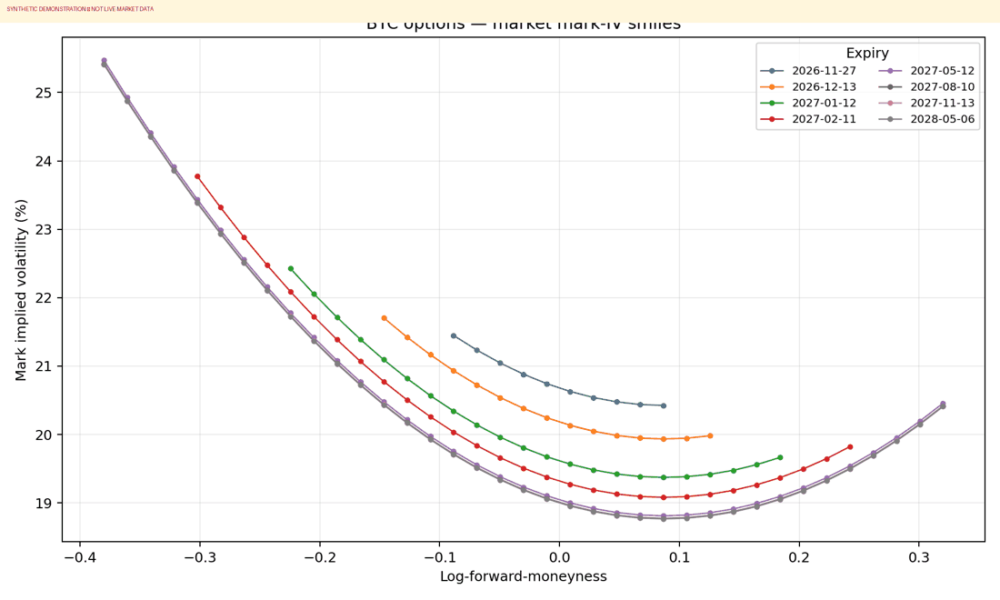
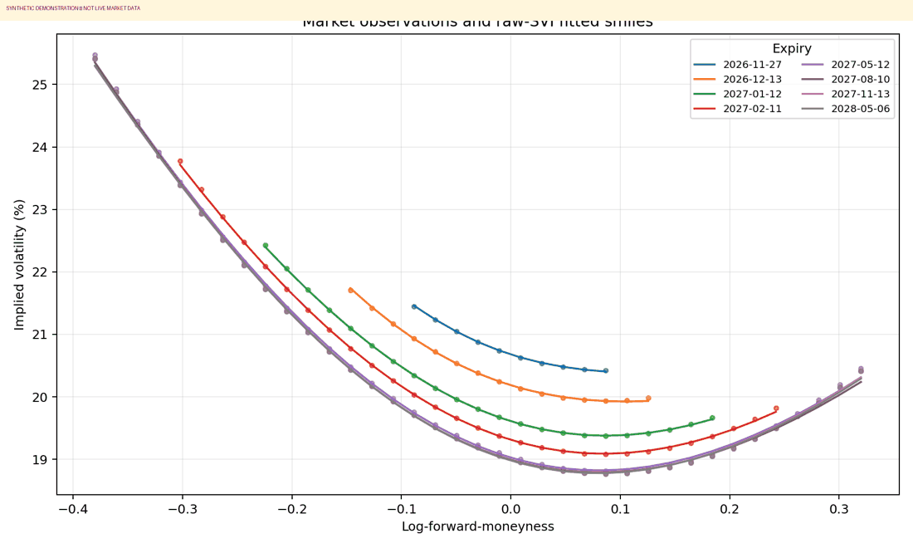
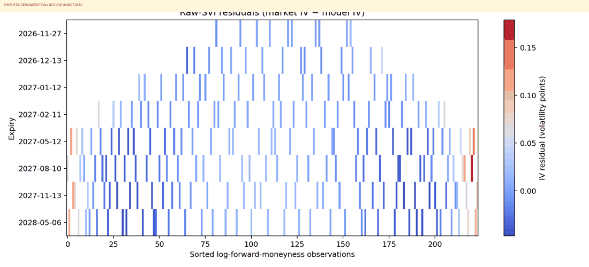

# European Equity Index Options — Implied Volatility Surface Calibration

**Quantitative finance research project | EURO STOXX 50 (SX5E) reference underlying | Black–76 inversion | SVI | SSVI | static-arbitrage diagnostics | 2D/3D visualizations**

**Author:** Mohamed Rejili

> **Data integrity.** The included sample is **SYNTHETIC**, constructed solely to demonstrate the complete pipeline. It is **not** Eurex market data. To study actual listed European index options, supply a licensed or publicly distributable CSV of option quotes using the schema below. The project makes no unsupported claim of free, live, full-chain Eurex access.

## Research question

Can a parsimonious parametric model reproduce the strike and maturity structure of European index-option implied volatility while preserving sensible numerical behavior? We implement a full, inspectable chain: **option quotes → no-arbitrage price bounds → Black–76 implied volatilities → total implied variance → SVI slices → SSVI global fit → numerical diagnostics and charts**.

The reference market is options on the **EURO STOXX 50** index, commonly traded on Eurex. These are European-style index options in the sense of their exercise convention; do not confuse that term with a generic option listed in Europe. Actual contract conventions (multiplier, settlement, currency, expiries and data licensing) must be confirmed with the data vendor and exchange.

## Why the European equity index market?

Index option smiles often display pronounced downside skew, reflecting demand for protection, jump risk and risk premia. The volatility term structure changes with expected uncertainty and market conditions. Fitting each expiry independently is easy but can create inconsistent cross-expiry behavior; global surface parameterizations help organize that information.

## Market data: realistic and honest approach

**Option A — Offline reproducible demo (works immediately).** The repository generates a labelled synthetic chain resembling the geometry of an index-option smile. No network request is needed; every plot is derived from this synthetic chain.

**Option B — Actual market CSV.** Export or license a chain from a provider that covers EURO STOXX 50 options, for example an exchange-approved Eurex data product or another provider with the appropriate rights. Save a CSV with:

| Column | Units | Description |
|---|---|---|
| `instrument_name` | text | unique instrument identifier |
| `expiry_date` | YYYY-MM-DD | contract expiry |
| `strike` | index points | option strike |
| `forward` | index points | synchronized forward price for the expiry |
| `maturity` | years | ACT/365.25 year fraction from quote timestamp |
| `option_type` | `call` or `put` | payoff type |
| `bid` / `ask` | index points | option prices **after** adjusting for contract multiplier if necessary |
| `discount_factor` | dimensionless | discount factor to expiry |
| `open_interest` | contracts, optional | liquidity weighting |

Use a **single synchronized timestamp** where possible. Different maturities can use different forwards and discount factors. In real applications, forward inputs can be obtained from matched index futures or derived from put–call parity using consistent quotes. Do not silently substitute spot for forward.

### Price conventions

The Black–76 formula assumes a discounted forward-style European option payoff with prices in consistent index-point units. Verify whether your provider reports prices in index points, euros, or contract-value units. The project does not pretend to infer unknown contract multipliers or financing conventions automatically.

## Mathematical foundations

### 1. European option payoffs

For terminal index level \(S_T\) and strike \(K\), the European call payoff is \((S_T-K)^+\) and put payoff is \((K-S_T)^+\). Under a risk-neutral pricing measure and suitable discounting, the option price is the discounted expectation of the payoff.

### 2. Black–76 forward pricing

For forward \(F_T\), discount factor \(D(T)\), maturity \(T>0\) and volatility \(\sigma>0\), define

$$
d_1=\frac{\log(F_T/K)+\tfrac12\sigma^2T}{\sigma\sqrt{T}},\qquad d_2=d_1-\sigma\sqrt{T}.
$$

Then

$$
C=D(T)\left[F_T\Phi(d_1)-K\Phi(d_2)\right],
$$

$$
P=D(T)\left[K\Phi(-d_2)-F_T\Phi(-d_1)\right].
$$

Here \(\Phi\) denotes the standard normal cumulative distribution function. The forward formulation avoids introducing a constant-dividend assumption into each individual option price, provided the forward is measured consistently.

### 3. Implied volatility inversion

Given an observed mid quote \(P_{\mathrm{mkt}}=(\mathrm{bid}+\mathrm{ask})/2\), find \(\sigma\) satisfying

$$
P_{\mathrm{Black76}}(F_T,K,T,\sigma,D)=P_{\mathrm{mkt}}.
$$

The project uses **Brent's bracketing root finder** (`scipy.optimize.brentq`) over a positive volatility interval. It rejects crossed markets, nonpositive quotes, invalid maturities and quotes outside the Black–76 lower/upper bounds. Root finding can fail when prices are extremely close to intrinsic value or outside the configured volatility bracket; those observations are excluded rather than assigned arbitrary volatilities.

### 4. Moneyness and total implied variance

Absolute strikes are difficult to compare across maturities because the forward level changes. We use

$$
k=\log(K/F_T), \qquad w(k,T)=T\,\sigma_{\mathrm{imp}}(k,T)^2.
$$

The function \(w\) is **total implied variance**. A surface calibration should generally fit \(w\) or appropriately weighted option prices rather than treating all IV points as equally informative.

### 5. Raw SVI parameterization

For a fixed maturity, the five-parameter SVI form is

$$
w(k)=a+b\left[\rho(k-m)+\sqrt{(k-m)^2+\eta^2}\right].
$$

- \(a\): vertical level of total variance.
- \(b>0\): scale of the smile's slopes.
- \(-1<\rho<1\): left/right asymmetry.
- \(m\): horizontal translation.
- \(\eta>0\): curvature scale.

For observed pairs \((k_i,w_i)\), we minimize

$$
\min_{a,b,\rho,m,\eta}\sum_i \omega_i\,[w_{\mathrm{SVI}}(k_i)-w_i]^2.
$$

The optimizer is bounded nonlinear least squares (`scipy.optimize.least_squares`) with multiple initializations. The default positive weights combine a capped open-interest proxy with a penalty for wide bid–ask spreads. These are **heuristic weights**, not a likelihood derived from a complete quote-noise model.

**Caveat:** a bounded SVI fit is not automatically free of butterfly arbitrage; independently fitted expiries can also cross in total variance.

### 6. SSVI: a linked surface parameterization

The SSVI form links smile geometry to the at-the-money total variance \(\theta(T)\):

$$
w(k,\theta)=\frac{\theta}{2}\left[1+\rho\varphi(\theta)k+\sqrt{(\varphi(\theta)k+\rho)^2+1-\rho^2}\right].
$$

We use a power-law smile function

$$
\varphi(\theta)=\eta\theta^{-\gamma}, \qquad \eta>0,\quad 0<\gamma<1.
$$

For each expiry, \(\theta(T)\) is estimated from the observation closest to forward ATM and linearly interpolated across maturities. The implementation calibrates global \((\rho,\eta,\gamma)\) by weighted least squares. This approximation is easy to audit but can be noisy if the observed ATM strike grid is sparse. A more advanced version should jointly smooth \(\theta(T)\), enforce its monotonicity and implement the precise sufficient conditions from Gatheral–Jacquier.

### 7. Fit metrics

For market and fitted implied volatility values \(\sigma_i\) and \(\hat\sigma_i\):

$$
\mathrm{RMSE}=\sqrt{\frac1N\sum_i(\sigma_i-\hat\sigma_i)^2},\qquad
\mathrm{MAE}=\frac1N\sum_i|\sigma_i-\hat\sigma_i|.
$$

These are **in-sample** errors. They measure fit to the calibration data, not forecasting skill or trading profitability. Errors in implied-volatility points are distinct from errors in option price; vega weighting can be useful when optimizing price fit.

### 8. Static-arbitrage diagnostics

**Calendar consistency.** At fixed log-forward-moneyness \(k\), a commonly used surface consistency check is that total variance should not decrease as maturity increases:

$$
w(k,T_2)\geq w(k,T_1)\quad\text{for }T_2>T_1.
$$

The code evaluates this numerically on a finite \(k\)-grid. This is a model diagnostic under the chosen forward/discount conventions, not a blanket claim about every possible calendar-spread trade.

**Butterfly consistency.** For a smooth total-variance smile, define

$$
g(k)=\left(1-\frac{kw'(k)}{2w(k)}\right)^2-\frac{w'(k)^2}{4}\left(\frac1{w(k)}+\frac14\right)+\frac12w''(k).
$$

The condition \(g(k)\geq0\), together with appropriate boundary behavior and other regularity assumptions, is related to nonnegative risk-neutral density. The code approximates derivatives with centered finite differences and reports negative grid values. It is **not** a mathematical certificate of no arbitrage.

## Installation

Python 3.10+ is recommended.

```bash
python -m venv .venv
# Linux/macOS: source .venv/bin/activate
# Windows: .venv\\Scripts\\activate
pip install -e '.[dev]'
```

## Reproduce the full demonstration

```bash
python scripts/generate_demo.py
python scripts/prepare_dataset.py --input data/raw/synthetic_eurostoxx50_options.csv
python scripts/run_analysis.py --input data/processed/european_options_clean.csv --output-dir reports
pytest -q
```

**Using actual European market quotes:** replace the synthetic input with a properly formatted CSV of real option bid/ask quotes and execute the same preparation and analysis commands. The output files do not change their meaning, but the research conclusions should clearly identify the vendor and quote timestamp.

## Figures and reports

| Output | Interpretation |
|---|---|
| `reports/market_smiles.png` | observed IV against log-forward-moneyness, separated by expiry |
| `reports/market_surface.html` | interactive 3D **scatter** of observed IV (not interpolated market quotes) |
| `reports/svi_fits.png` | raw observations overlaid with fitted SVI curves |
| `reports/svi_surface.html` | interactive 3D SVI model surface |
| `reports/residual_heatmap.png` | residual heatmap for the raw-SVI fit |
| `reports/svi_parameters.csv` | calibrated parameters and solver status |
| `reports/ssvi_parameters.json` | global SSVI parameters |
| `reports/calibration_metrics.csv` | in-sample SVI fit errors |
| `reports/arbitrage_diagnostics.json` | finite-grid calendar and butterfly checks |

### Preview of synthetic-demo outputs







The charts under `figures/demo/` in this repository were produced from the **synthetic** dataset and are labelled accordingly. They illustrate expected visualizations; they must not be cited as evidence about current EURO STOXX 50 market conditions.

## Project structure

```text
european-index-volatility-surface/
├── README.md
├── pyproject.toml
├── requirements.txt
├── src/volsurface/
│   ├── cleaning.py           # Black-76 pricing, inversion, quality filters
│   ├── demo.py               # explicitly synthetic example chain
│   ├── surface.py            # total variance transformations
│   ├── svi.py                # independent smile calibration
│   ├── ssvi.py               # linked global surface fit
│   ├── diagnostics.py        # numerical arbitrage warning checks
│   └── plotting.py           # Matplotlib and Plotly figures
├── scripts/
│   ├── generate_demo.py
│   ├── prepare_dataset.py
│   └── run_analysis.py
├── figures/demo/
├── data/raw/
├── data/processed/
├── reports/
└── tests/
```

## Limitations and next research steps

1. **Data access:** no unverified free real-time Eurex option-chain API is assumed. Live European option data may require a commercial license or authorized access.
2. **Synthetic versus empirical:** the bundled plots are demonstration results; they cannot validate a claim about real market skew.
3. **Quote alignment:** actual bid/ask quotes, futures forwards and discount factors must be synchronized.
4. **No-arbitrage:** the implementation reports numerical diagnostics but does not enforce all sufficient SVI/SSVI conditions.
5. **Maturity interpolation:** the current SSVI ATM term structure is interpolated, not jointly regularized.
6. **Validation:** add held-out strikes and multiple market dates; compare out-of-sample price and IV errors.
7. **Model comparison:** extend to SABR, constrained SVI and arbitrage-free SSVI.
8. **Risk:** analyze option vega, delta and hedging implications, accounting for model and market convention risk.

## References

- Black, F. (1976). *The pricing of commodity contracts*. Journal of Financial Economics.
- Gatheral, J. and Jacquier, A. (2014). *Arbitrage-free SVI volatility surfaces*. Quantitative Finance.
- Gatheral, J. (2006). *The Volatility Surface: A Practitioner's Guide*. Wiley.
- [Eurex Exchange](https://www.eurex.com/) — product specifications and market-data access conditions.
- [STOXX](https://stoxx.com/) — EURO STOXX 50 index information.

## Author

**Mohamed Rejili** — quantitative finance research and Python implementation.